# Run Pele

**用 Pele 将 Mermaid 变成可交付的 SVG 与 HTML。** 中文优先的图表 skill、本地 CLI 与案例库：从流程、系统架构到数据关系、消息时序和数量流，保留可编辑源码与可复现输出。

<p align="center">
  
</p>

<p align="center">
  <a href="#快速开始">快速开始</a> ·
  <a href="#案例导航">案例导航</a> ·
  <a href="SKILL.md">技能入口</a> ·
  <a href="https://skills.sh/krpct/run-pele/run-pele">skills.sh</a> ·
  <a href="references/syntax.md">语法参考</a> ·
  <a href="README.en.md">English</a>
</p>

`Pele 1.10.0` · `Node.js 20+` · `MIT` · 本地渲染，无浏览器依赖

## 案例导航

下列 12 组案例覆盖 **12 种不同图型**，展示分组、异常回路、异步补偿、领域模型、依赖计划和数量守恒。图中业务、计划与指标均为演示内容。

所有图都由 **Pele 实际渲染**，不是截图替代品，也不是 GitHub 自带 Mermaid 的渲染结果。点击图像可打开完整 SVG；手机上可结合下方文字与源码查看细节。

| 场景 | 图型 | 图中可以读到什么 |
| --- | --- | --- |
| [01 · 从提交到灰度](#case-delivery-pipeline) | `flowchart` | 并行检查 · 质量门禁 · 灰度与回滚 |
| [02 · 订单平台](#case-platform-topology) | `architecture` | 四层分组 · 定向端口 · 网格对齐 |
| [03 · 支付 Saga](#case-checkout-saga) | `sequence` | 幂等请求 · 库存预占 · 异步消息 · 退款补偿 |
| [04 · 交易领域](#case-commerce-domain) | `er` | 七类实体 · 主外键 · 基数 · 唯一约束 |
| [05 · 订阅生命周期](#case-subscription-lifecycle) | `state` | 复合状态 · 宽限期 · 延迟取消 · 恢复 |
| [06 · 发布计划](#case-release-roadmap) | `gantt` | 三个阶段 · 十二项计划 · 工作日与依赖 |
| [07 · 能源账本](#case-energy-budget) | `sankey` | 三类供给 · 多级流量 · 数量守恒 |
| [08 · 跨部门退货](#case-returns-process) | `swimlane` | 四个责任泳道 · 两级决策 · 异常路径 |
| [09 · 发布准备](#case-release-readiness) | `mindmap` | 五个检查维度 · 十五个执行条目 |
| [10 · 需求追踪](#case-requirement-trace) | `requirement` | 高风险需求 · 验证方式 · 满足与追踪关系 |
| [11 · 分支协作](#case-branching-strategy) | `gitGraph` | 五条分支 · 热修复回灌 · 版本标签 |
| [12 · 性能观察](#case-service-latency) | `xychart` | 八个时间点 · 柱线叠加 · 单位与范围 |

## 快速开始

```sh
git clone https://github.com/KRPCT/run-pele.git
cd run-pele
npm ci --ignore-scripts --no-audit --no-fund

# 生成一张图，再生成可直接打开的中文 HTML
node scripts/render.mjs examples/delivery-pipeline.mmd delivery.svg
node scripts/render.mjs examples/checkout-saga.mmd checkout.html --lang zh-CN

# 校验已有 Markdown 中的 Mermaid 围栏
node scripts/render.mjs --check notes.md
```

渲染器使用锁文件中的精确版本。脚本不上传源码、不启动服务器，默认保护已有输出；确需替换时加 `--force`。

作为 skill 使用，可通过 [Skills CLI](https://github.com/vercel-labs/skills) 安装。Skills CLI 需要 **Node.js 22.20+**；本地 Pele 渲染脚本需要 Node.js 20+。

```sh
npx skills add KRPCT/run-pele --skill run-pele
```

安装前可运行 `npx skills add KRPCT/run-pele --list`，确认发现 `run-pele`。[skills.sh 详情页](https://skills.sh/krpct/run-pele/run-pele)提供同一来源的安装入口。

安装器中选择客户端和作用域。依赖缺失时，从安装后的技能目录运行 `npm ci --ignore-scripts --no-audit --no-fund`。

> 使用 $run-pele 绘制支付 Saga：包含幂等请求、库存预占、异步支付回调、过期补偿与失败重试。输出 Mermaid 源码、SVG 和中文 HTML，并校验结果。

## 工程与业务案例

前四组直接展开，其余案例按需展开。每组均保留 `.mmd`、完整 SVG 和单图生成命令；README 中的主题、排版与固定渲染参数由 `npm run showcase` 统一复现。

<a id="case-delivery-pipeline"></a>

### 01 · 从提交到灰度：软件交付链路

流程不止一条成功路径：审核后并行执行单元测试、类型检查和依赖扫描，汇合到质量门禁；制品签名、预发布验收、灰度放量与回滚分别有明确落点。

**展示构造：** `subgraph` 分组、组内方向、条件边、并行汇合与异常回路。

[](assets/readme/delivery-pipeline.svg)

[查看 Mermaid 源码](examples/delivery-pipeline.mmd) · [打开完整 SVG](assets/readme/delivery-pipeline.svg)

```sh
node scripts/render.mjs examples/delivery-pipeline.mmd delivery-pipeline.html --lang zh-CN
```

<a id="case-platform-topology"></a>

### 02 · 订单平台：服务边界与数据通路

12 个服务与存储节点分布在入口、业务、数据和可观测性四层。固定连接侧与行列对齐，适合解释服务边界和基础设施拓扑。

**展示构造：** `architecture-beta`、内置图标、`group`、端口方向与 `align row/column`。

[](assets/readme/platform-topology.svg)

[查看 Mermaid 源码](examples/platform-topology.mmd) · [打开完整 SVG](assets/readme/platform-topology.svg)

```sh
node scripts/render.mjs examples/platform-topology.mmd platform-topology.html --lang zh-CN
```

<a id="case-checkout-saga"></a>

### 03 · 支付 Saga：异步事件与补偿

六个参与方共同完成下单：处理重复请求、预占库存、创建支付单，随后消费异步支付事件；库存预占失效时进入补偿退款。

**展示构造：** 自动编号、激活区间、`alt/else`、异步消息、跨参与方备注。

[](assets/readme/checkout-saga.svg)

[查看 Mermaid 源码](examples/checkout-saga.mmd) · [打开完整 SVG](assets/readme/checkout-saga.svg)

```sh
node scripts/render.mjs examples/checkout-saga.mmd checkout-saga.html --lang zh-CN
```

<a id="case-commerce-domain"></a>

### 04 · 交易领域：订单、支付与退款模型

客户、订单、明细、商品、支付、发货和退款组成交易模型。订单价格快照与商品目录分离，退款追溯到支付记录，主外键和唯一约束直接可见。

**展示构造：** 七类实体、属性表、PK/FK/UK、关系基数与识别关系。

[](assets/readme/commerce-domain.svg)

[查看 Mermaid 源码](examples/commerce-domain.mmd) · [打开完整 SVG](assets/readme/commerce-domain.svg)

```sh
node scripts/render.mjs examples/commerce-domain.mmd commerce-domain.html --lang zh-CN
```

<a id="case-subscription-lifecycle"></a>

<details>
<summary><strong>05 · 订阅生命周期：续费、暂停与恢复</strong> — 复合状态 · 宽限期 · 延迟取消 · 恢复</summary>

有效订阅内部包含正常使用与续费两个子状态；外围处理试用到期、扣款失败、宽限期、暂停、恢复，以及当前账期结束后取消。

**展示构造：** 复合状态、起止节点、状态别名、带事件的迁移与说明注记。

[](assets/readme/subscription-lifecycle.svg)

[查看 Mermaid 源码](examples/subscription-lifecycle.mmd) · [打开完整 SVG](assets/readme/subscription-lifecycle.svg)

```sh
node scripts/render.mjs examples/subscription-lifecycle.mmd subscription-lifecycle.html --lang zh-CN
```

</details>

<a id="case-release-roadmap"></a>

<details>
<summary><strong>06 · 发布计划：依赖、关键路径与里程碑</strong> — 三个阶段 · 十二项计划 · 工作日与依赖</summary>

三阶段、十二项计划，把契约评审、迁移设计、前后端实现、联调、故障演练、灰度与全量发布串成有依赖的时间线。

**展示构造：** 任务状态、`after` 依赖、关键路径、里程碑与排除周末。渲染参考时间固定为 2026-10-26。

[](assets/readme/release-roadmap.svg)

[查看 Mermaid 源码](examples/release-roadmap.mmd) · [打开完整 SVG](assets/readme/release-roadmap.svg)

```sh
node scripts/render.mjs examples/release-roadmap.mmd release-roadmap.html --lang zh-CN
```

</details>

<a id="case-energy-budget"></a>

<details>
<summary><strong>07 · 能源账本：来源、分配与损耗</strong> — 三类供给 · 多级流量 · 数量守恒</summary>

三路输入合计 800 个示例能耗单位，经配电系统流向计算、冷却、网络、辅助与损耗；计算和冷却再向下拆分。中间节点的流入与流出保持一致。

**展示构造：** 多级 Sankey、CSV 数据、Unicode 名称、带权流量与渐变连接。

[](assets/readme/energy-budget.svg)

[查看 Mermaid 源码](examples/energy-budget.mmd) · [打开完整 SVG](assets/readme/energy-budget.svg)

```sh
node scripts/render.mjs examples/energy-budget.mmd energy-budget.html --lang zh-CN
```

</details>

<a id="case-returns-process"></a>

<details>
<summary><strong>08 · 跨部门退货：规则、验收与退款</strong> — 四个责任泳道 · 两级决策 · 异常路径</summary>

客户、客服、仓库和财务各有责任泳道。资格不符和验收异常都有处理路径，正常路径则从寄回商品继续到入库、核算和退款到账。

**展示构造：** 四泳道、双重决策、跨部门交接、失败分支与纵向布局。

[](assets/readme/returns-process.svg)

[查看 Mermaid 源码](examples/returns-process.mmd) · [打开完整 SVG](assets/readme/returns-process.svg)

```sh
node scripts/render.mjs examples/returns-process.mmd returns-process.html --lang zh-CN
```

</details>

<a id="case-release-readiness"></a>

<details>
<summary><strong>09 · 发布准备：从契约到恢复证据</strong> — 五个检查维度 · 十五个执行条目</summary>

从产品契约、代码依赖、数据恢复、运行观测和验证证据五个维度展开，每个维度包含三个具体检查项。

**展示构造：** 缩进层级、中心主题、五个一级分支与十五个叶子节点。

[](assets/readme/release-readiness.svg)

[查看 Mermaid 源码](examples/release-readiness.mmd) · [打开完整 SVG](assets/readme/release-readiness.svg)

```sh
node scripts/render.mjs examples/release-readiness.mmd release-readiness.html --lang zh-CN
```

</details>

<a id="case-requirement-trace"></a>

<details>
<summary><strong>10 · 需求追踪：风险与实现责任</strong> — 高风险需求 · 验证方式 · 满足与追踪关系</summary>

三个高风险支付需求分别落到审计日志、重试 worker 和幂等存储，并记录验证方法。恢复能力与重复副作用防护之间保留追踪关系。

**展示构造：** `requirement`、`element`、风险、验证方式、`satisfies` 与 `traces`。

[](assets/readme/requirement-trace.svg)

[查看 Mermaid 源码](examples/requirement-trace.mmd) · [打开完整 SVG](assets/readme/requirement-trace.svg)

```sh
node scripts/render.mjs examples/requirement-trace.mmd requirement-trace.html --lang zh-CN
```

</details>

<a id="case-branching-strategy"></a>

<details>
<summary><strong>11 · 分支协作：并行开发与热修复</strong> — 五条分支 · 热修复回灌 · 版本标签</summary>

主线、开发分支、两条功能分支与热修复分支同时出现。紧急修复进入已发布版本后，再回灌开发分支，最后形成下一个版本。

**展示构造：** 五条分支、提交类型、分支切换、多路合并、热修复回灌与版本标签。

[](assets/readme/branching-strategy.svg)

[查看 Mermaid 源码](examples/branching-strategy.mmd) · [打开完整 SVG](assets/readme/branching-strategy.svg)

```sh
node scripts/render.mjs examples/branching-strategy.mmd branching-strategy.html --lang zh-CN
```

</details>

<a id="case-service-latency"></a>

<details>
<summary><strong>12 · 性能观察：同轴比较 P50 与 P95</strong> — 八个时间点 · 柱线叠加 · 单位与范围</summary>

八个时间点同时展示 P50 柱形与 P95 折线，纵轴统一为毫秒；11:00 的峰值随后回落，便于比较常见请求与长尾请求的变化。

**展示构造：** 离散时间轴、数值范围、单位标注、柱线叠加。所有数值均为演示数据。

[](assets/readme/service-latency.svg)

[查看 Mermaid 源码](examples/service-latency.mmd) · [打开完整 SVG](assets/readme/service-latency.svg)

```sh
node scripts/render.mjs examples/service-latency.mmd service-latency.html --lang zh-CN
```

</details>

## 同一份源码，三种主题

颜色由 `--pele-*` CSS 变量控制。源码和图结构保持相同，只改变背景、文字、节点与边的颜色。字体变化会影响尺寸，需要重新测量；颜色变化无需重新布局。


```css
.diagram {
  --pele-bg: #16212d;
  --pele-fg: #e3eaf1;
  --pele-surface: #293b4d;
  --pele-line: #a8bdce;
  --pele-border: #6f8b9e;
}
```

内联 SVG 可以继承页面主题；通过 HTML 图片元素加载的独立 SVG 需要自带样式。本仓库的展示图包含完整背景和主题，便于在 GitHub 明暗页面中阅读。

## 不止这些案例：33 类图型与 591 个示例

案例区用于展示复杂场景；[完整语法索引](references/syntax.md) 与 [示例库](assets/examples.json) 用于实际编写。591 个不同示例来自 32 个官方示例页，每个条目保留来源 URL、代码块编号与章节；第 33 类 `info` 是诊断图型。

| 关系或信息 | 可选图型 |
| --- | --- |
| 流程与交互 | Flowchart、Swimlane、Sequence、State、Use case、Agentflow |
| 系统与结构 | Architecture、C4、Class、ER、Block、Requirement |
| 时间与协作 | Gantt、Git graph、Timeline、Journey、Kanban、Event modeling |
| 数量与比较 | XY chart、Pie、Sankey、Radar、Quadrant、Packet、Venn |
| 层次与分析 | Mindmap、Tree view、Treemap、Ishikawa、Cynefin、Wardley map |
| 语法与诊断 | Railroad（含 EBNF / ABNF / PEG）、Info |

```sh
node scripts/catalog.mjs
node scripts/catalog.mjs --type sequence --search critical
node scripts/catalog.mjs --type railroad --search railroad-peg-beta
node scripts/catalog.mjs --type swimlane --example 1
```

## 可复现，而不只是看起来正确

```sh
# 重建标题区、12 组案例和主题对照
npm run showcase

# 渲染语料、复杂案例，并检查错误与恢复边界
npm run verify
```

- **591 个官方来源示例 × 2 种宽度 = 1,182 次语料渲染。**
- **12 组复杂案例 × 2 种宽度 = 24 次案例渲染。**
- 检查类型覆盖、非法语法、未知图型、输入/输出限额、core/lazy 入口、Markdown 错误位置、已有文件保护与 worker 超时终止。
- 展示图记录源文件、输出文件、Pele 版本、尺寸和 SHA-256；Gantt 的参考时间固定，便于复现。

[展示图清单](assets/readme/manifest.json) · [验证摘要](validation/summary.json) · [来源与覆盖](references/sources.md)

[Skills CLI 安装验证](validation/skills-cli.json)记录从公开仓库发现、复制安装及安装后运行检查的结果。

这些检查不等同于全部上游测试或安全认证；591 个语料示例没有逐一完成目视审查。Node 字宽估计、浏览器字体和 PNG/PDF 导出仍需按目标环境核对。

## 在应用中使用 Pele

```js
import { mount } from 'pele';

const diagram = mount(container, source, {
  links: false,
  images: false,
  onError(error) {
    status.textContent = error.message;
  },
});

diagram.update(nextSource);
// 组件卸载时释放观察器。
diagram.destroy();
```

| 你要做什么 | 入口 |
| --- | --- |
| 编写图表、找关键字和模式 | [语法与图型](references/syntax.md) |
| 生成 SVG/HTML、校验 Markdown | [本地 CLI](references/local-cli.md) |
| 接入 Node、浏览器、按需加载、数学 | [API 与集成](references/api-and-integration.md) |
| 调整字体、主题、窄屏与导出 | [主题与布局](references/theming-and-layout.md) |
| 处理不可信输入和 Mermaid 迁移 | [安全与兼容](references/security-and-compatibility.md) |
| 查找现有 CLI、skill 和 MCP | [生态参考](references/ecosystem.md) |

## 能力边界

**需要 Chrome 或 Puppeteer 吗？** 生成 SVG 不需要；浏览器用于检查实际字体和最终页面展示。

**是否兼容 Mermaid.js 的全部行为？** Pele 目标为 [Mermaid 12.1.0 语法](https://pele.run/compatibility)，使用自己的布局，不保证逐像素一致；ZenUML 等外部插件不在范围内。

**这是官方 CLI 或 MCP 吗？** 这是独立 skill 和本地包装脚本，不是 Obsidian 官方 CLI，也不提供 MCP 服务。

**可否直接导出 PNG/PDF？** 当前包装脚本输出 SVG/HTML。位图或文档导出需要额外转换，并核对 CSS 变量、字体和数学标记。

**会上传我的图表吗？** 本地渲染脚本不上传源码；链接和图片默认禁用。远程资源、发布和分享由调用方显式选择。

## 来源与许可

[Pele 官方文档](https://pele.run/) · [官方 API](https://pele.run/api) · [Pele 源码](https://github.com/obsidianmd/pele)

本项目采用 [MIT](LICENSE)，上游示例与组件保留[第三方许可](references/third-party-notices.md)。由 [KRPCT](https://github.com/KRPCT) 维护。
