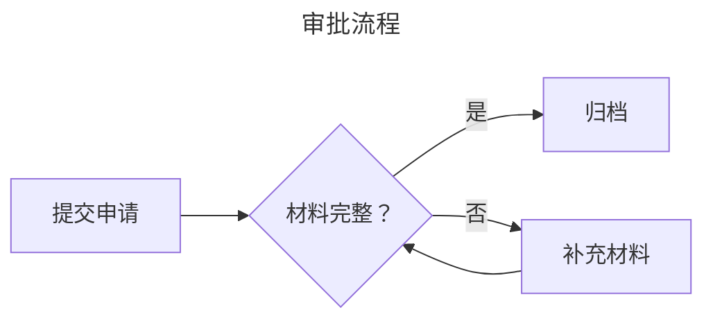
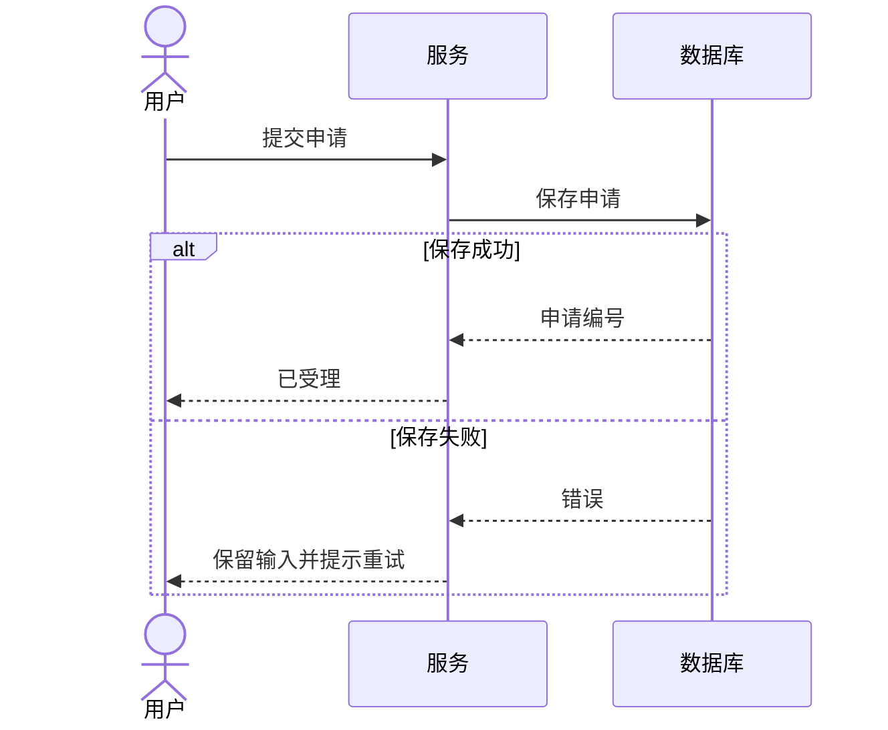

# 语法与模式

按关系选图，而不是按视觉相似度选图。下面是从官网全部 32 个示例页与兼容性表提取的操作索引；`info` 是额外的诊断图型。完整示例语料在 `assets/examples.json`，通过 `scripts/catalog.mjs` 按需读取，保留每段的页面 URL、代码块编号和章节。

## 共同语法

- 图型首行之前可有 YAML frontmatter；正文中的 `%%` 是注释，也可出现 `%%{init: ...}%%` 配置指令。支持程度取决于图型。
- 先使用明确的语法关键字，再写结构。普通标题不能放在图型首行前冒充图型。
- ID 与展示名分离，例如 `request["提交申请"]`。括号、冒号、引号和特殊符号出现在标签中时，优先使用该图型的引号形式；不要直接拼接未转义用户文本。
- 缩进对 mindmap、tree view、Ishikawa、treemap 等表达层次的图型具有语义。不能随意格式化成同一缩进。
- `accTitle: ...`、`accDescr: ...` 及多行描述在支持的图型中生成 SVG 可访问性信息。为多图分配不同 ID 前缀。
- Markdown 标签、HTML 的有限文本样式与数学表达式由各图型支持，不能把任意 HTML 或脚本当作标签能力。数学 `$$...$$` 默认显示 TeX，需要宿主 resolver 才会排版。
- 同一配置出现在 `RenderOptions.config`、frontmatter 和 init 指令时，源码配置可覆盖默认配置；应用传入的安全选项仍由宿主控制。



## 流程、交互、结构

“查询名”是 `--type` 参数；“模块名”用于 `pele/diagrams/<模块名>` 与 `load()`，注意大小写。

| 查询名 / 模块名 | 精确首行 | 关系与主要构造 |
| --- | --- | --- |
| flowchart | `flowchart LR`、`graph TD` | 步骤、决策与依赖；`A[文字]`、`B(文字)`、`C{决策}`、`D[(存储)]`；`-->`、`-.->`、`==>`、边标签；`subgraph ... end`；`direction`；`classDef`、`class`、`style`、`linkStyle`；`@{ shape: ... }` 扩展形状 |
| swimlane | `swimlane-beta LR` | 责任分工；`subgraph` 表示泳道，步骤属于泳道，跨道边表示交接；支持 TB；不能用普通 flowchart 分组假定相同泳道布局 |
| sequence | `sequenceDiagram` | 消息时序；`participant`、`actor`、`as`；`->>` 请求、`-->>` 返回；`activate` / `deactivate`；`loop`、`alt` / `else`、`opt`、`par`、`critical`、`break`；`Note over`；`autonumber` |
| state | `stateDiagram-v2`、`stateDiagram` | 状态迁移；`[*]` 起止；`A --> B: 事件`；`state "名称" as id`；复合状态 `{ ... }`；choice、fork、join；并发分区 `--` |
| class | `classDiagram` | 类型结构；`class Name { ... }`、可见性 `+ - # ~`；`<|--` 继承、`*--` 组合、`o--` 聚合、`..>` 依赖；基数与关系标签；namespace、note |
| er | `erDiagram` | 实体与基数；`CUSTOMER ||--o{ ORDER : places`；实体块内 `type name PK/FK/UK`；实/虚线区分识别关系；方向与分组示例可检索 |
| architecture | `architecture-beta` | 服务及端口连接；`group id(cloud)[名称]`、`service db(database)[名称] in group`、`junction`；`a:R --> L:b` 指定连接侧；`align row` / `align column`；自定义图标需要 resolver |
| c4 | `C4Context` / `C4Container` / `C4Component` / `C4Dynamic` / `C4Deployment` | 软件架构的不同层次；`Person`、`System`、`Container`、`Component`、边界块与 `Rel`；部署用 `Deployment_Node`；不要混淆 C4 Container 与运行时容器概念 |
| block | `block`、`block-beta` | 明确的网格安排；`columns N`、`id:跨度`、`space`、嵌套 `block ... end`、方向箭头；需要手动安排块时使用 |
| usecase | `usecase-beta` | 角色与目标；`actor Customer("顾客")`、`Login("登录")`、`systemBoundary ... end`；`-->` 关联、`--|>` 泛化、`Checkout ..> : include Payment`、`Discount ..> : extend Checkout`；note、JSON 节点 |

### 交互模式



流程图表达控制关系；时序图表达参与方之间随时间发生的消息；状态图表达单个对象允许的状态变化。需要三个视角时分别绘图，不要在一张图中混用语法。

## 时间、任务与层次

| 查询名 / 模块名 | 精确首行 | 关系与主要构造 |
| --- | --- | --- |
| gantt | `gantt` | 日期任务；`dateFormat YYYY-MM-DD`、`section`；`任务 :id, 2026-10-26, 3d`、`after id`、`active`、`done`、`crit`、`milestone`；重现输出时传固定 `now` |
| git / gitGraph | `gitGraph` | 提交与分支；`commit id:"..."`、`branch`、`checkout`、`merge`、`cherry-pick`、标签和提交类型；分支必须先存在 |
| kanban | `kanban` | 状态列；缩进的列与任务，`id[标题]`，任务 `@{ assigned: ..., priority: ... }` 等元数据；只是图，不提供拖拽看板或任务持久化 |
| timeline | `timeline` | 事件时间线；`title`、`section`、`时间 : 事件 : 另一事件`；同一时间可追加事件；日期标签与 Gantt 的可计算日期不同 |
| journey | `journey` | 体验分数；`section`，`任务: 分数: 参与者1, 参与者2`；分数与参与者含义要来自真实业务数据 |
| mindmap | `mindmap` | 中心主题与缩进子主题；`root((主题))`；不同括号形状、图标声明、Markdown 标签；缩进决定父子 |
| treeview / treeView | `treeView-beta` | 文件或分类树；缩进树或 `├──` / `└──`；`## 描述`、`:::highlight`、`icon(...)`；自定义图标和配置需要额外支持 |
| treemap | `treemap`、`treemap-beta` | 层次面积；缩进类别和 `"叶子": 数值`；仅用于有合理面积意义的非负数据，不能把目录树的每项当作等面积事实 |

## 数量、集合与分析

| 查询名 / 模块名 | 精确首行 | 关系与主要构造 |
| --- | --- | --- |
| pie | `pie` | 部分占整体；`title` / `showData`，`"分类" : 数值`；避免类别过多，核对总量 |
| xychart | `xychart`、`xychart-beta` | 柱/线；`x-axis [标签...]`、`y-axis "名称" min --> max`、`bar [...]`、`line [...]`；数组长度与单位由作者核对，不能仅凭渲染成功判断数据一致 |
| quadrant / quadrantChart | `quadrantChart` | 二维象限；`x-axis 左 --> 右`、`y-axis 下 --> 上`、`quadrant-1` 到 `quadrant-4`、`名称: [x,y]`；通常使用 0–1 坐标 |
| sankey | `sankey`、`sankey-beta` | 带数量的流动；CSV `来源,目标,数值`，含逗号或引号按 CSV 转义；Pele 支持 Unicode；不要用百分号代替核对单位 |
| radar | `radar-beta` | 多维比较；`axis id["轴名"]`，`curve id["系列"]{数值...}`；`min`、`max`、`graticule`；各轴量表应可比较 |
| packet | `packet`、`packet-beta` | 位段；`0-15: "Source Port"`、单点范围或 `+长度`；校验位范围、重叠和实际协议定义 |
| venn | `venn-beta` | 集合重叠；`set A["Alpha"]:20`、`union A,B["共同部分"]:3`、缩进 `text` 子项；关键字是 `union`，含义结合展示区解读，勿自行改成 `intersection` |
| ishikawa | `ishikawa`、`ishikawa-beta` | 问题—类别—原因的缩进树；窄屏可改为原因树；`fishbone` 不是图型关键字 |
| cynefin | `cynefin-beta` | 判断域；`complex`、`complicated`、`clear`、`chaotic`、`confusion` 下放项目，域间可连边；分类是用户的领域判断，渲染器不会判定 |
| wardley | `wardley-beta` | 价值链；`anchor` / `component 名称 [visibility,evolution]`、`->` 依赖、`evolve`、`pipeline`、`evolution`、note/annotation；注意坐标顺序是可见度在前、演化程度在后 |

### 数量流模式

```mermaid
sankey
采购,生产,100
生产,销售,85
生产,损耗,15
```

数字能解析不代表正确。比如 Sankey 的 `50%` 会被读为 50；源与汇的守恒、量纲、缺失值、XY 点数必须根据实际数据另行核对。

## 专门语言

| 查询名 / 模块名 | 精确首行 | 模式 |
| --- | --- | --- |
| requirement | `requirementDiagram` | `requirement id { id: ... text: ... risk: ... verifymethod: ... }`、`element`；`element - satisfies -> requirement`；还包括 contains、copies、derives、refines、traces、verifies；关系箭头方向按含义核对 |
| eventmodeling | `eventmodeling` | `tf` / `timeframe`，`rf` / `resetframe`；类型 `ui`、`cmd` / `command`、`evt` / `event`、`pcr` / `processor`、`rmo`；`[[Data]]` 引用与 `data Name { ... }`；`->>` 帧关联 |
| agentflow | `agentflow-beta TB` | `flow id[名称] ... end`、`global`、`connector`；节点 `@{ shape: input/task/tool/decision/refdoc/action }`；connectorRef、instruction、params、returns 是图数据，不会执行远程请求 |
| railroad | `railroad-beta` | 显式组合：`terminal()`、`nonterminal()`、`sequence()`、`choice()`、`optional()`、`zeroOrMore()`、`oneOrMore()` |
| railroad | `railroad-ebnf-beta` | `rule = "literal" other ;`；`|` 选择、`?` 可选、`*` / `+` 重复、`[ ... ]` 可选组 |
| railroad | `railroad-abnf-beta` | `rule = ... ;`；`/` 选择、`1*DIGIT` 等重复、`[ ... ]` 可选；按此方言示例编写 |
| railroad | `railroad-peg-beta` | `Rule <- ... ;`；`/` 有序选择、`!Keyword` 否定前瞻、`*` / `+` 重复；不要把 EBNF 的 `|` 直接搬入 |
| info | `info` | 显示版本信息的诊断类型；没有独立示例页，不能算作业务图型 |

```mermaid
railroad-ebnf-beta
identifier = letter (letter | digit | "_")* ;
letter = "a" | "b" | "c" ;
digit = "0" | "1" | "2" ;
```

## 复杂语法的检索方法

不要从表格猜完整文法。先查同一图型的真实范例，复制结构并保持关键字大小写：

```sh
node scripts/catalog.mjs --type sequence --search critical
node scripts/catalog.mjs --type flowchart --search "shape:"
node scripts/catalog.mjs --type architecture --search "align column"
node scripts/catalog.mjs --type usecase --search include
node scripts/catalog.mjs --type railroad --search railroad-peg-beta
node scripts/catalog.mjs --type wardley --search pipeline
```

完整语法可从 [官网示例](https://pele.run/examples) 的 Markdown 对应文件查到；源快照在 [来源索引](sources.md)。这份索引提取可操作模式，不声称是每个 parser 的完整形式文法，也不承诺所有 Mermaid 配置均生效。
